<div align="center">

# Crossbar

**A console front end for Linux gaming PCs and Linux on PS5.**<br>
Boot straight to the couch. Every game, app, song, show and friend — from a controller.


[Install](#install) · [Features](#whats-in-it) · [Guide](docs/GUIDE.md) · [Changelog](CHANGELOG.md) · [Roadmap](ROADMAP.md)

</div>

| Cross-media bar (PS3 style) | Dashboard (Xbox 360 style) |
|---|---|
| 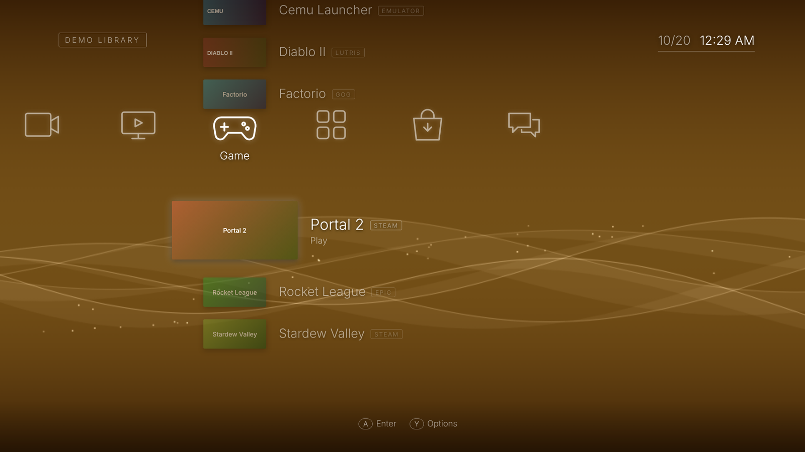 | 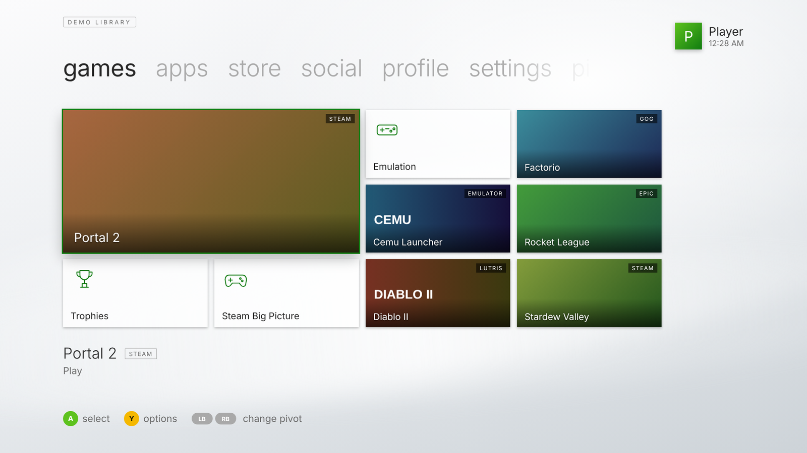 |

Crossbar replaces the desktop with a console menu. Steam, GOG, Epic, Lutris and 27 emulated systems
in one list; Flatpaks and AppImages; music, Spotify, video, IPTV and a TV-sized web browser; Discord
voice, calls and screen share; torrents behind a VPN. A Quick Menu draws over any game.

It installs next to the system you already have (CachyOS works great, including on a PS5). It
**never touches your kernel or graphics drivers**, and the install can be undone.

> **Alpha.** Used daily on a PC and a PS5, but expect rough edges. If something breaks,
> **Settings › System › Share Support Report** gives you a link to paste into an issue.

---

## Contents

- [What's in it](#whats-in-it)
- [Two interfaces](#two-interfaces)
- [The Quick Menu](#the-quick-menu)
- [Tour](#tour)
- [Install](#install)
- [Controls](#controls)
- [When something goes wrong](#when-something-goes-wrong)
- [Make it yours: themes and looks](#make-it-yours-themes-and-looks)
- [Branches and updates](#branches-and-updates)
- [For developers](#for-developers)
- [Known gaps](#known-gaps)

## What's in it

**Games**
- **Every library in one list:** Steam, GOG and Epic (install, play, uninstall), plus Lutris games
  and Steam's non-Steam games. Each has a tag you can rename: [STEAM], [GOG], [LUTRIS]…
- **Windows games** run through Proton (umu-launcher). Each game gets its own tool picker, launch
  options, environment variables and Windows components (winetricks / protontricks).
- **A built-in download manager** for GE-Proton, Proton-CachyOS, Wine-GE, DXVK and more.
- **Emulation** reads an EmuDeck folder as-is: 27 systems including Switch (Eden), one-press
  emulator installs, and BIOS and key checks.
- **Trophies** from Steam and RetroAchievements, in the menu and in-game.
- **Artwork** from SteamGridDB or your own pictures.

**Play and keep playing**
- **A Quick Menu over any game** (Select + Start). It has trophies, friends and party, volume per
  app, a frame-rate overlay sized for a 4K TV, an app switcher and power.
- **Game mode** frees the menu's memory while you play.
- **Memory Guard** closes a game that runs out of memory instead of letting the whole console freeze.
- **The menu goes quiet behind games:** no animation and almost no polling while a game loads or plays.

**Media**
- **Music** from your files and **Spotify** (Crossbar becomes a Spotify Connect speaker).
- **Video** with a controller-made player that remembers where you stopped.
- **Photos**, **IPTV** (live TV, movies, series), **TV apps** (YouTube TV, Twitch, Plex, Jellyfin…),
  and **network drives** (SMB / NFS).
- **A web browser made for the controller:** link-to-link navigation, readable at 4K.

**Social**
- **Discord voice:** join your channels, call friends, mute, deafen and share the screen, all from
  the menu or in-game.
- **Steam and Discord friends:** who's online and what they're playing.

**Network**
- **A VPN set up from the controller:** WireGuard or OpenVPN; PIA, Mullvad, NordVPN, Proton and more.
- **Port forwarding**, and **split tunnelling** (only the apps you choose use the VPN).
- **Leak tests** and a **speed test**.
- **A torrent client** on qBittorrent's engine, with search plugins and VPN binding.

**Yours**
- **Two complete interfaces** that switch live, plus theme packs and a starter kit for making
  [your own console skin](docs/LOOKS.md).
- **Remappable buttons**, and Xbox / PlayStation / Nintendo button glyphs.
- **Your own folders** in any category.

**PS5**
- Temperatures, a temperature overlay, fan target, front light and boost.
- Boots alongside the PS5 setup's gaming mode and Plasma, and switches between them.

## Two interfaces

**Settings › Theme › Interface** picks the front end. Crossbar starts in it from a cold boot,
and switching reloads the menu (a few seconds) and brings you back to Theme. Only the chosen
interface is ever loaded, so the other one costs no memory. Underneath it's one menu: the same games,
folders, Options, dialogs, keyboard and controller mapping.

- **Cross-media bar (PS3 style).** Categories run across, items run down, folders push a new column,
  and flowing waves sit behind (month colours or your theme pack).
- **Dashboard (Xbox 360 style).** Lowercase pivots run across the top (**LB / RB**). Under them is a
  sideways wall of tiles led by a big one: whatever you used last, the game you just played, the
  film you were watching (with its poster), or the live channel (with its logo). What's playing sits
  centred at the top with its progress bar. Lists have a details pane, and Options slides in from
  the right. Choose **Background** (Light, Dark, Green or your theme pack's picture) and **Accent Colour**.

| Dashboard settings | Now playing |
|---|---|
| 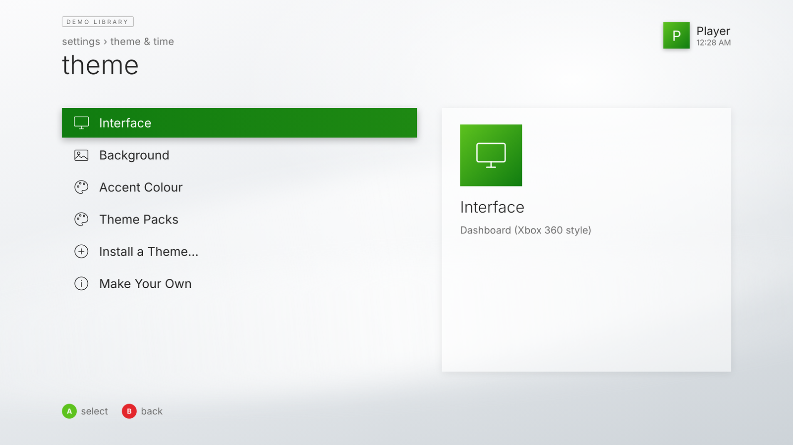 |  |

## The Quick Menu

Press **Select + Start** (or **Home**) in any game, video or app. A native overlay opens on top, like
Steam's or Discord's, and the game underneath stops seeing the controller until you close it. It
matches your interface: a side panel for the cross-media bar, or a centred, 360-sized **Guide**
with five tabs for the Dashboard.

| Guide (Dashboard) | Quick Menu (cross-media bar) |
|---|---|
| 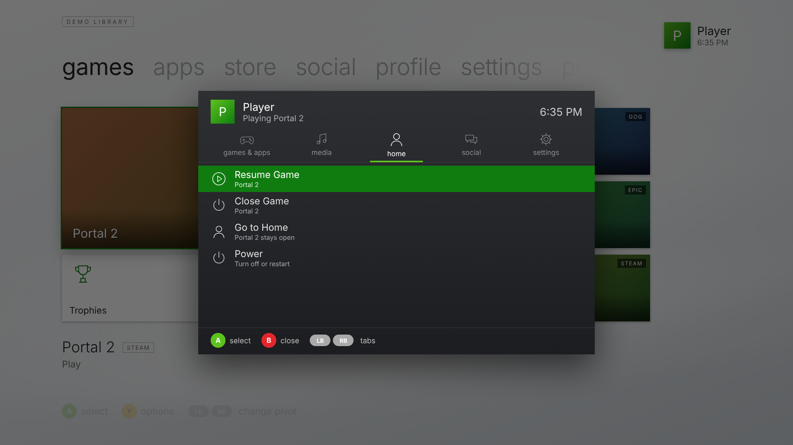 | 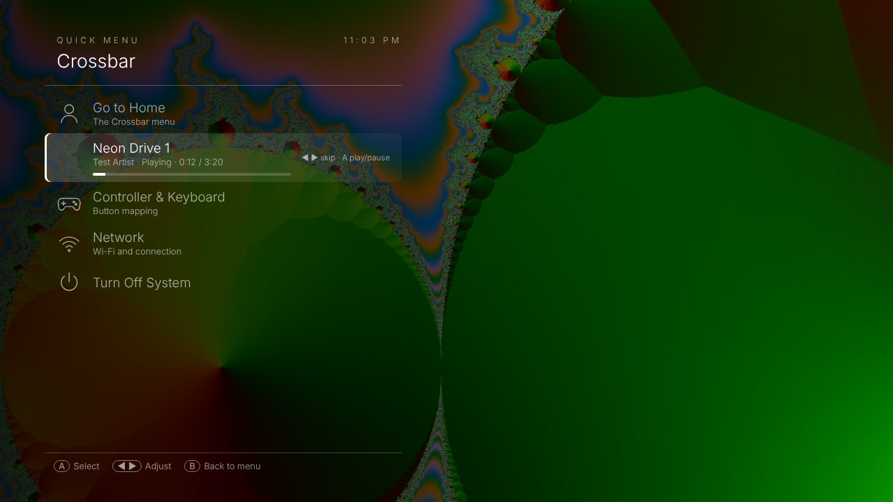 |
| 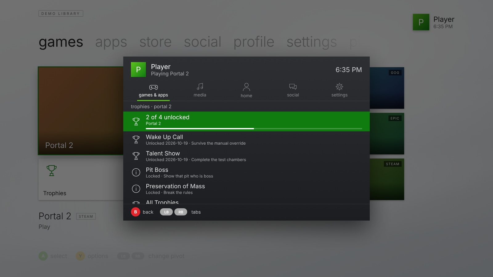 | 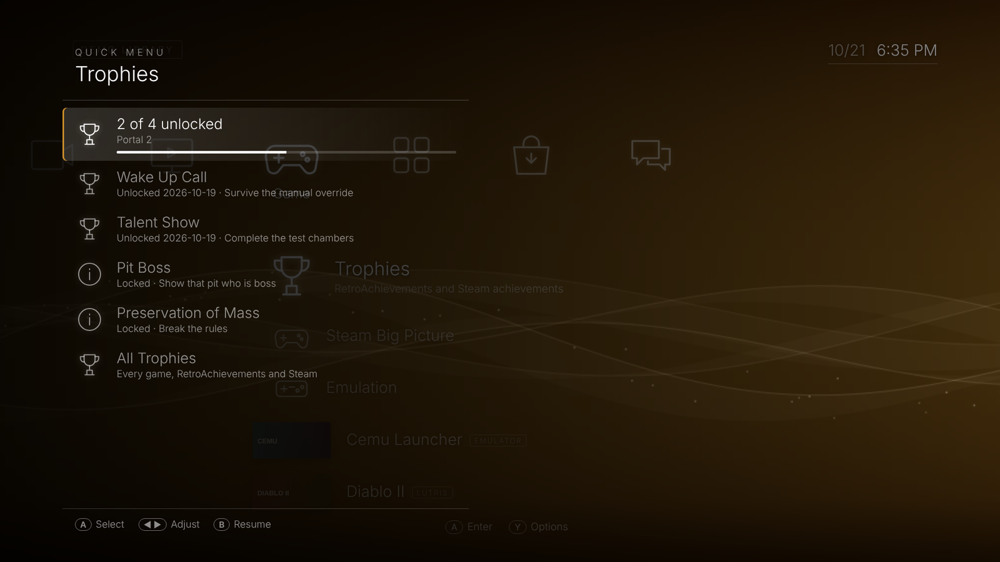 |
| 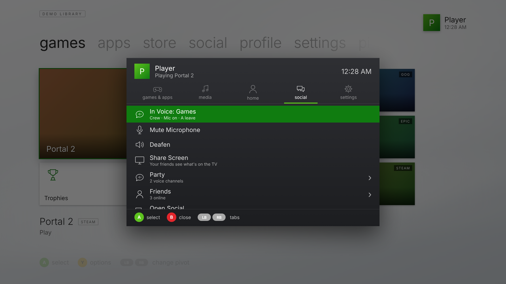 | 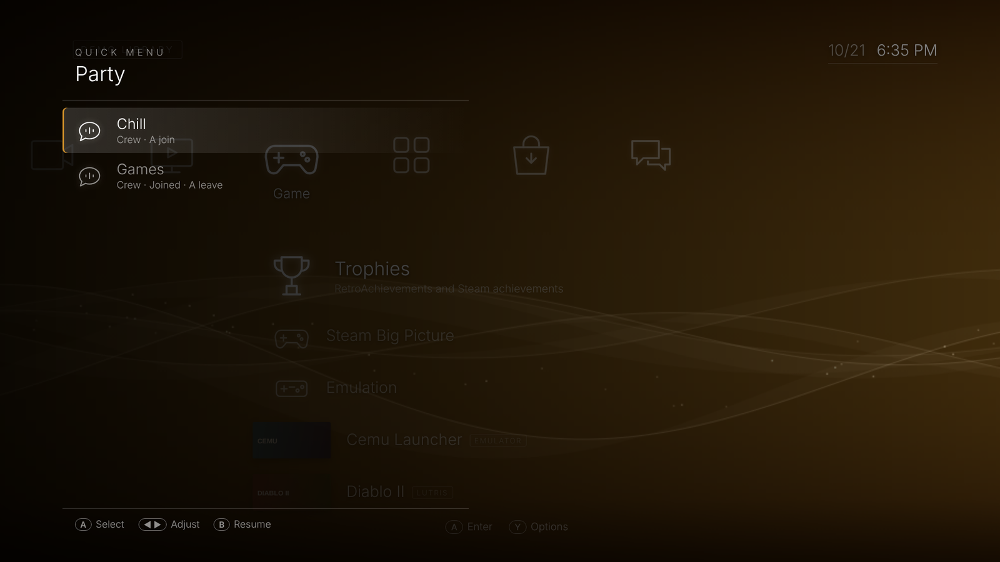 |

- **Resume, Close**, or **Go to Home** with the game left running.
- **Trophies** for the game you're playing, from Steam or from RetroAchievements (matched to what
  your emulator is running).
- **Friends & Party:**
  - join your Discord voice channels and see who's online;
  - call a friend;
  - mute, deafen, share the screen or leave.
- **Now Playing**, **Volume**, and **Sound ▸** (output, microphone, volume per app).
- **Performance ▸**: the frame-rate overlay (MangoHud) and the PS5 temperature overlay. Each has its
  own corner and size, from Small to Huge for a 4K TV.
- **Switch App**, **Keyboard**, **Settings**, and **Power** (Power opens on Cancel).

## Tour

| | | |
|---|---|---|
| 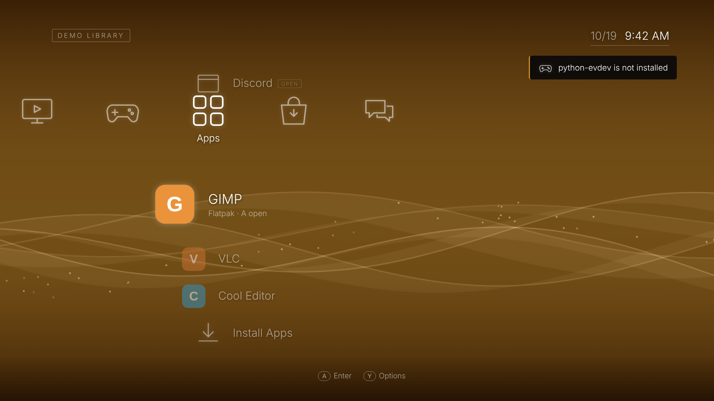 **Apps** — Flatpaks, AppImages, what's open now | 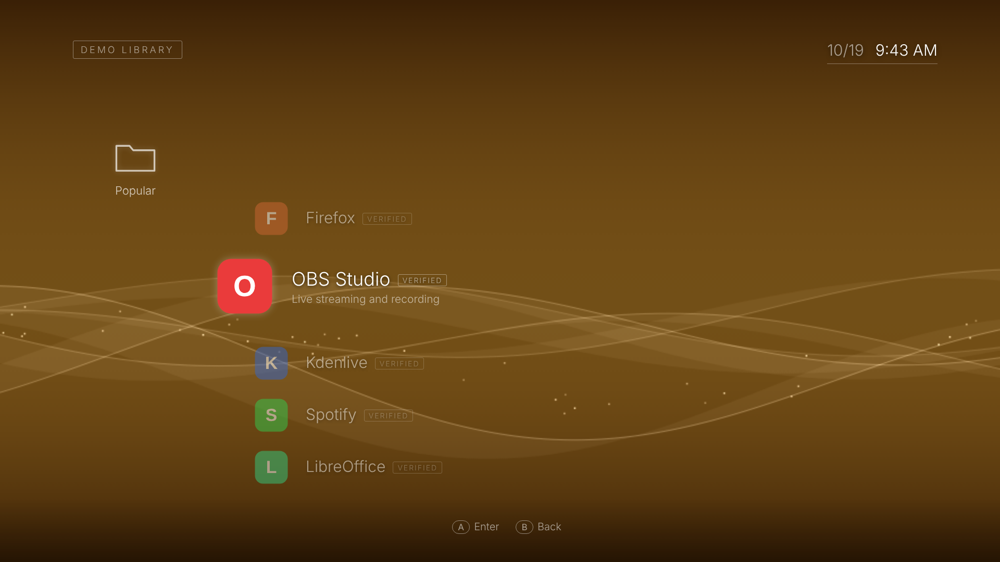 **Install Apps** — Flathub and AppImages |  **Social** — Discord voice and friends |
| 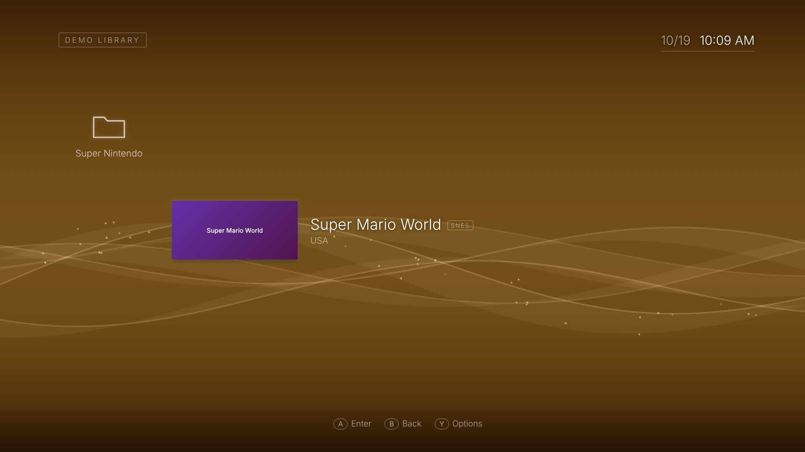 **Emulation** — 27 systems, EmuDeck layout | 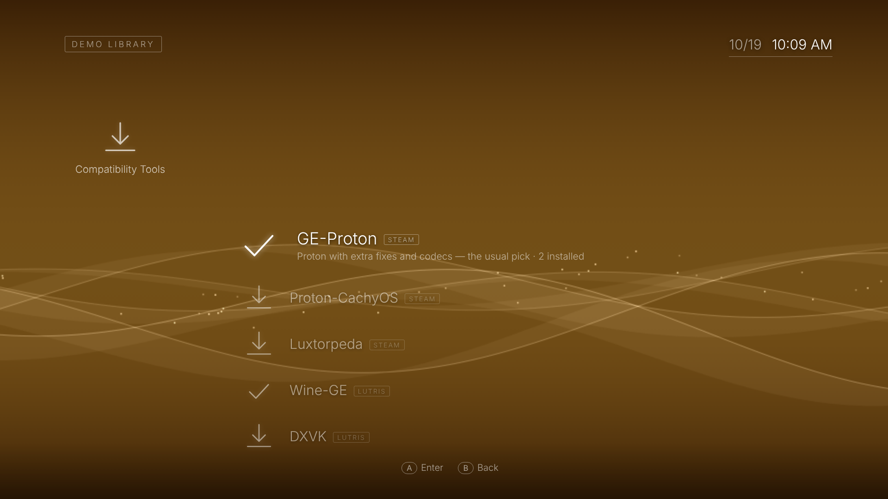 **Proton & Wine** — ProtonUp-Qt's tools, in Settings | 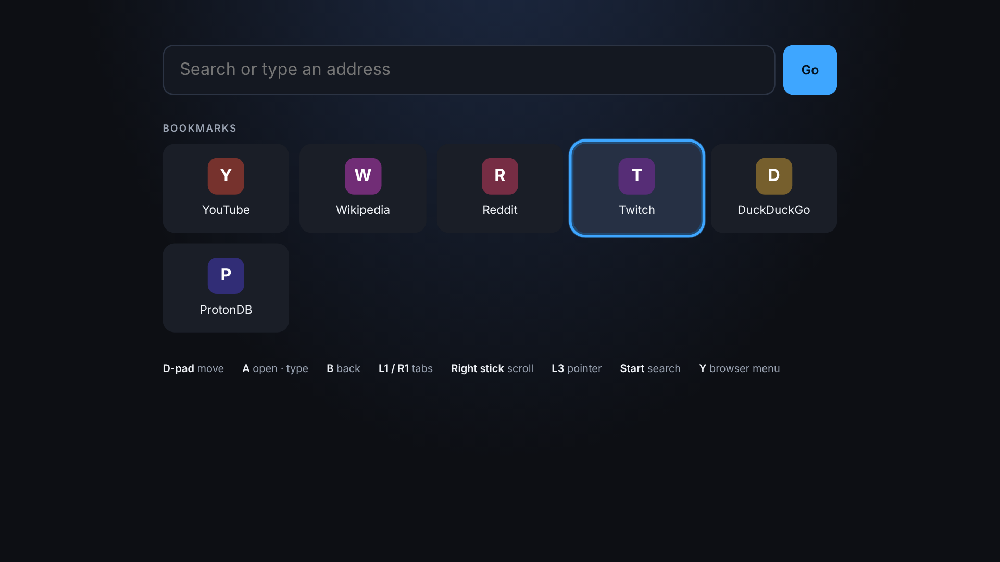 **Browser** — made for the controller |
|  **IPTV** — live TV, movies, series | 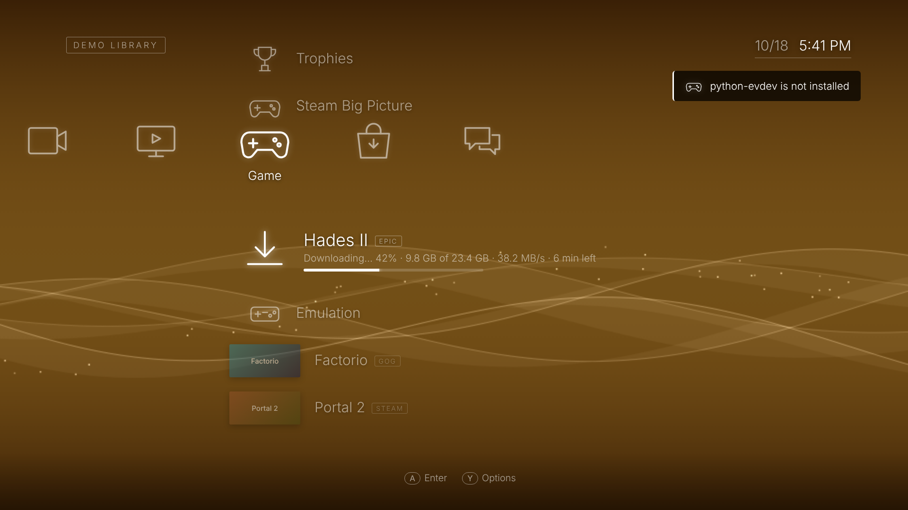 **Downloads** — speed, time left, cancel |  **Music** — files and Spotify |
| 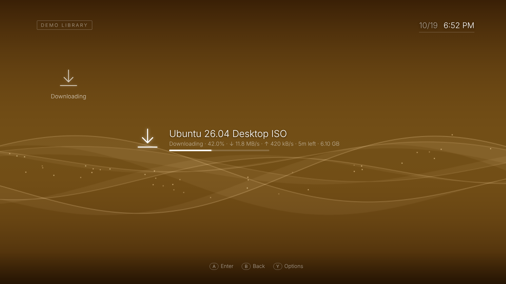 **Torrents** — search, download, seed | 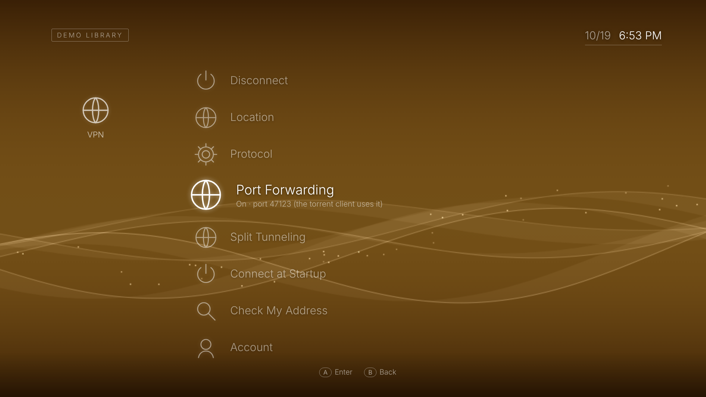 **VPN** — sign-in wizards, port forwarding | 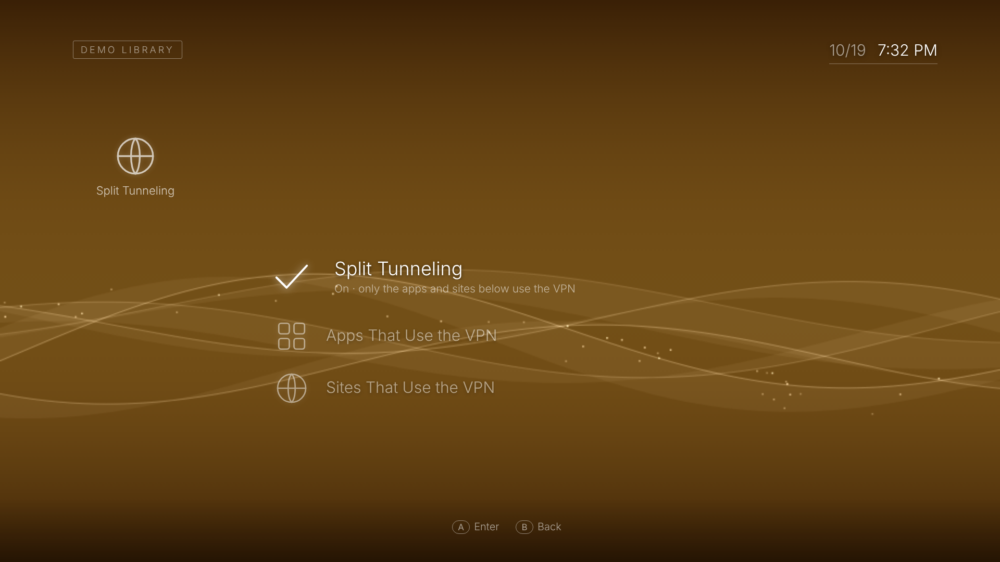 **Split tunnelling** — only the apps you pick |
| 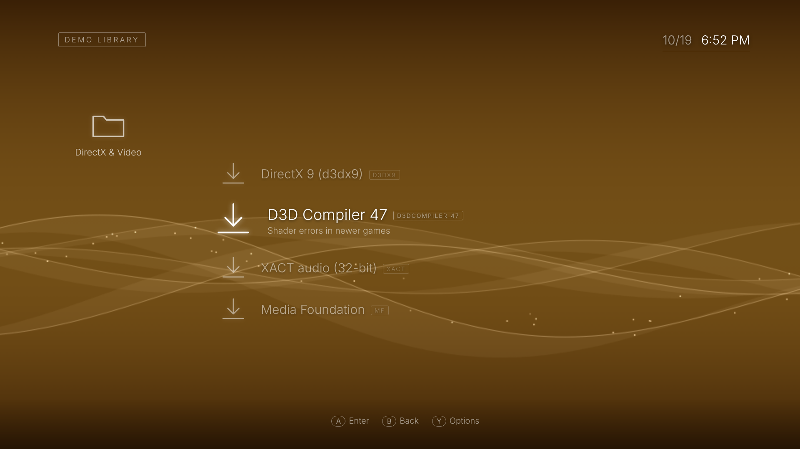 **Windows components** — per game |  **Artwork** — SteamGridDB or your pictures | 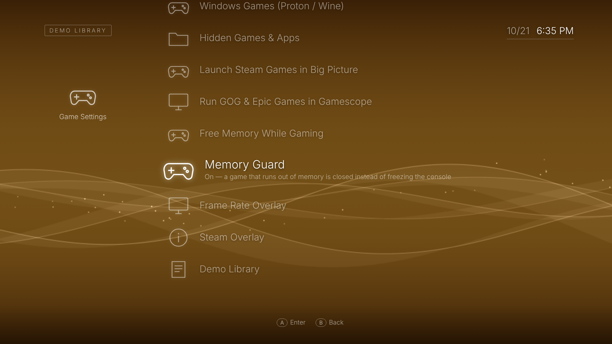 **Memory Guard** — no more frozen console |

Every feature is explained in the **[Guide](docs/GUIDE.md)**.

## Install

### On an existing CachyOS / Arch system (PS5 included)

```bash
sudo pacman -Syu                      # be fully up to date first
git clone https://github.com/Brenyd/crossbar.git && cd crossbar
./install-cachyos.sh                  # asks for your password once; fine over SSH
sudo reboot
```

The installer:
- adds the packages Crossbar needs, but **never mesa, Vulkan or a kernel**;
- installs Crossbar and its controller service;
- makes the machine boot into Crossbar.

Your own autologin and startup scripts stay as they are. A small marked block or drop-in is added,
and `./install-cachyos.sh --uninstall` puts everything back exactly. On the PS5 setup, Crossbar
becomes a third choice next to gaming mode and the desktop. If Crossbar ever fails to start, that
boot falls back to gaming mode. Details: [docs/INSTALL.md](docs/INSTALL.md).

Switch any time:
- In Crossbar: **Settings › System › Switch to Gaming Mode** or **Switch to Desktop**.
- In Plasma: **Return to Crossbar** in the app menu.

### Try it on your desktop (demo library, nothing installed)

```bash
git clone https://github.com/Brenyd/crossbar.git && cd crossbar
./dev-run.sh            # demo library in a Chromium app window
./dev-run.sh --real     # your real accounts
```

### Its own ISO, or a VM

```bash
./build-iso.sh          # on Arch / CachyOS -> out/crossbar-YYYY.MM.DD-x86_64.iso
./build-in-docker.sh    # from any distro with Docker or Podman
./run-vm.sh             # QEMU/KVM; NOGL=1 if the window is black, PAD=054c:0ce6 to pass a controller
```

From the live system, **Settings › Install to Disk** installs it permanently. That needs UEFI and
erases the chosen disk.

## Controls

| Action | Controller | Keyboard |
|---|---|---|
| Move | D-pad / left stick | Arrow keys |
| Select / Back | A ✕ / B ○ | Enter / Esc |
| Options for the highlighted item | Y △ | Tab |
| Quick Menu, over anything | **Select + Start** | Home, or Super+Esc |
| Change pivot / Guide tab (Dashboard) | LB / RB | |
| Previous / next track (cross-media bar) | LB / RB | Page Up / Page Down |
| Steam's overlay (Steam games) | Guide / PS | Shift+Tab |
| Terminal | | Ctrl+Alt+T |

Remap any button or key in **Settings › Controller & Keyboard**. A small root service reads the
controllers and sends each press only to what's on screen. While a game is in front, the game
reads the controller itself. More: [Guide › Controls](docs/GUIDE.md#controls).

## When something goes wrong

- **A game froze the whole console:** that's Linux running out of memory. **Memory Guard** (on by
  default, under Settings › Games & Emulation › Game Settings) now closes the game first and shows a
  notice instead.
- **Black screen after a game, and the menu won't come back:** open the Quick Menu, then try **Close**
  on the game, then **Go to Home**. If that still fails, run this over SSH:
  ```bash
  export XDG_RUNTIME_DIR=/run/user/$(id -u)
  export SWAYSOCK=$(ls $XDG_RUNTIME_DIR/sway-ipc.*.sock | head -1)
  rm -f $XDG_RUNTIME_DIR/crossbar-gamemode; swaymsg '[all] fullscreen disable'
  swaymsg exec /usr/local/bin/crossbar-shell        # restarts every Crossbar piece
  ```
  The last resort without rebooting is `sudo systemctl restart getty@tty1`. That logs the TV session
  out and back in.
- **Anything else:**
  - **Settings › System › Share Support Report** uploads a diagnostic report and gives you a link.
  - `crossbar-doctor` in the terminal prints the same report.
  - Logs are in `~/.cache/`: `crossbard.log`, `crossbar-shell.log`, `crossbar-overlay.log` and
    `crossbar-games.log`.
- **The controller works in the menu but not in videos or the Quick Menu:** check
  `systemctl status crossbar-inputd`, then **Settings › Controller & Keyboard › Controller
  Diagnostics**.

## Make it yours: themes and looks

- **Theme packs** ([docs/THEMES.md](docs/THEMES.md)) change colours, the background picture, the font,
  icons and sounds. Four are built in. To add one, install it from a folder or a .zip.
- **Looks** ([docs/LOOKS.md](docs/LOOKS.md)) are whole console skins. A look is a folder with three
  files: `look.json` (name, settings, colours, the Quick Menu's style), `look.js` (drawing code)
  and `look.css`.
  - Put the folder in `~/.local/share/crossbar/looks/` and it appears under Settings › Theme ›
    Interface.
  - Its settings show up in Settings › Theme automatically.
  - Start from the working template in `shell/web/looks/_template/`.

## Branches and updates

**Settings › System › Update Crossbar** installs the newest version. **Update Branch** in the same
place chooses where updates come from: `main` (stable) or a test branch. You can switch back and
forth. Updates install system parts too (services, device rules, packages), then restart Crossbar
in place.

Without the menu (over SSH or in the terminal):

```bash
curl -L https://github.com/Brenyd/crossbar/archive/refs/heads/main.tar.gz | tar xz
cd crossbar-main && ./update-system.sh
```

Contributing a change from your own branch: push it, open a pull request against `main`, and test
it on a console with **Update Branch** first.

## For developers

```
shell/server.py               backend: JSON API + serves the UI (Python stdlib only)
shell/crossbar/               providers (steam, gog, epic), system (sway), gamepad, quick (Quick Menu),
                              session (game mode), memguard, looks, media, player, spotify, vpn, torrent…
shell/overlay.py              the in-game Quick Menu: a GTK4 layer-shell window
shell/osk_window.py           the system on-screen keyboard (Wayland text-input)
shell/inputd.py               crossbar-inputd: root controller service (grab, virtual keyboard)
shell/web/xmb.js              the menu core and the look contract ("Shell seam")
shell/web/looks/<id>/         looks: xmb (PS3 style), x360 (Xbox 360 style), _template
iso/                          archiso overlay: packages, autologin, sway session, crossbar-shell
```

How it boots: tty1 autologin → sway → `crossbar-shell` → it starts the backend, the Quick Menu
overlay and a kiosk Chromium window, and restarts each one if it stops.

The front end is swappable. `xmb.js` owns the item model, folders, actions, Options, dialogs,
input routing and polling. A look only draws them. Run the demo with `python3 shell/server.py --demo`
and open http://127.0.0.1:7777.

## Known gaps

- Netflix, Disney+ and Spotify's web player need Widevine DRM, which Arch's Chromium doesn't ship.
- In YouTube's TV interface the controller works only if the site picks it up (arrow keys always work).
- The ISO installer erases the whole disk (no dual boot), and doesn't include NVIDIA drivers yet.
- Steam's library listing needs a Web API key; a QR sign-in through the client would be smoother.
- Discord voice is driven through Discord's own web client: no third-party voice UI is allowed.

What's next: [ROADMAP.md](ROADMAP.md) · Every change: [CHANGELOG.md](CHANGELOG.md)
