# Crossbar — prototype 0.11.2

An Arch-based live distro that boots straight into a console-style cross-media-bar shell:
flowing month-coloured waves, categories across, items down, folders, a △-style options
panel, and gamepad control.

Categories: **Users · Settings · Photo · Music · Video · TV & Video Services · Game · Store ·
Social**. See [ROADMAP.md](ROADMAP.md) for what's next. One Game list merges Steam, GOG and
Epic; Store downloads from all three; Music plays your files and Spotify; Video plays
anything mpv can, with a controller-friendly control panel.

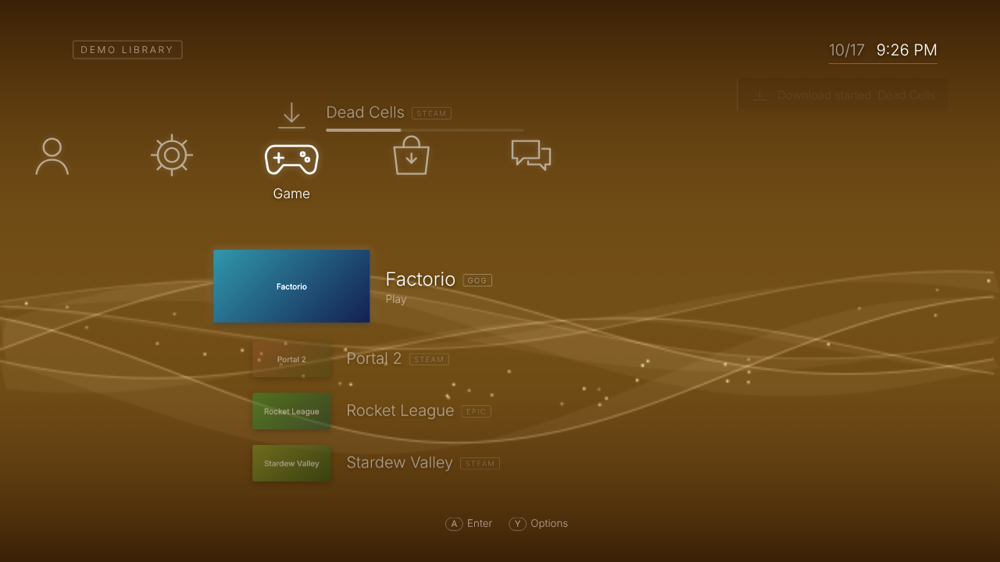

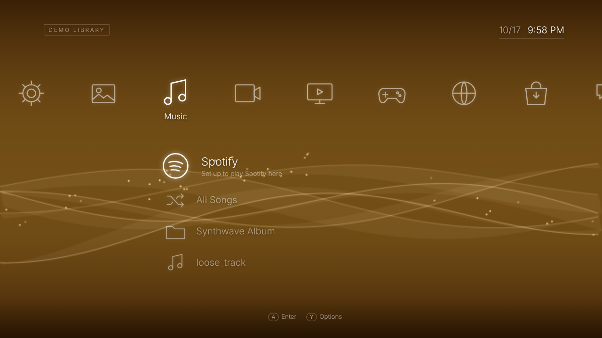

### What's new in 0.11

| | |
|---|---|
| 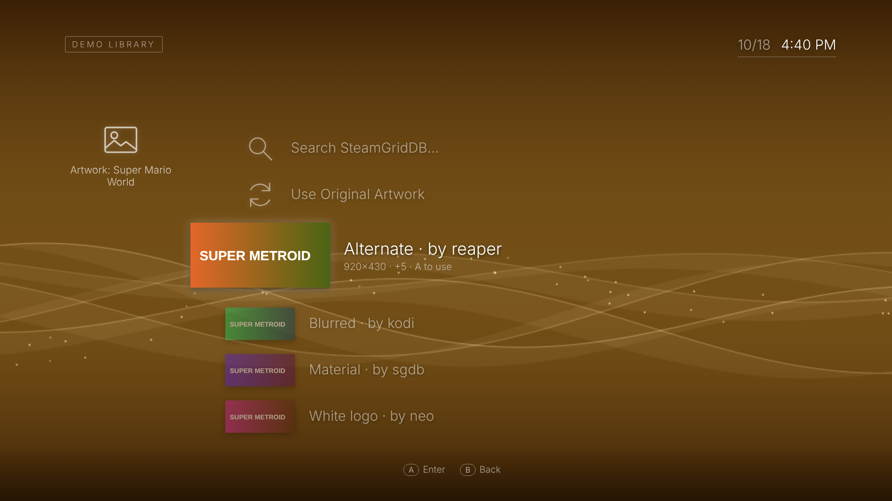 | 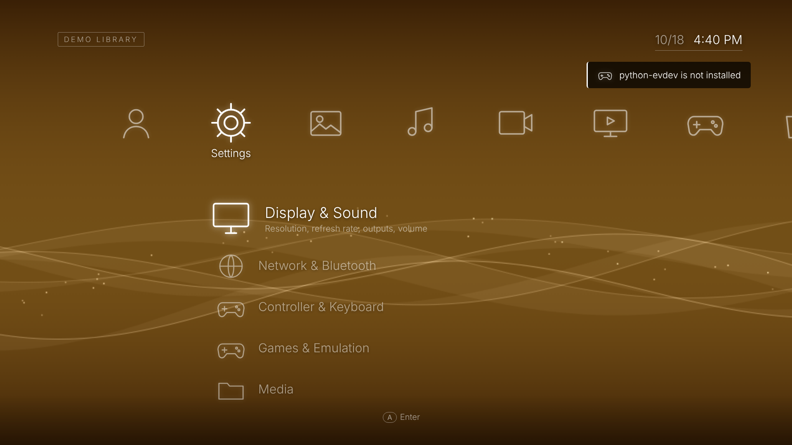 |
| **Change Artwork** — any game or ROM, from SteamGridDB's community art (Y › Change Artwork…) | **Tidier Settings** — related sections grouped: Display & Sound, Network & Bluetooth, Games & Emulation… |
| 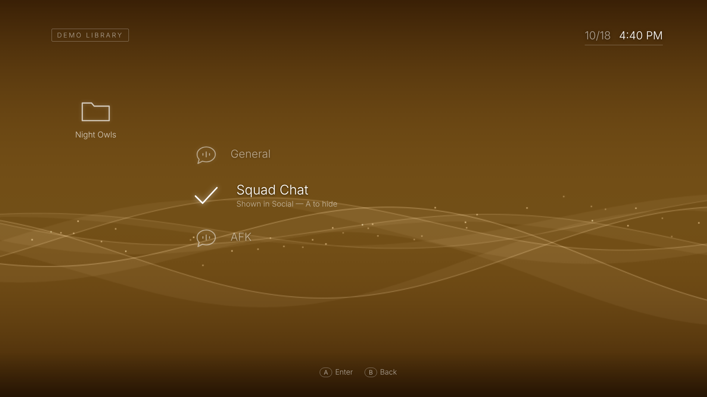 | 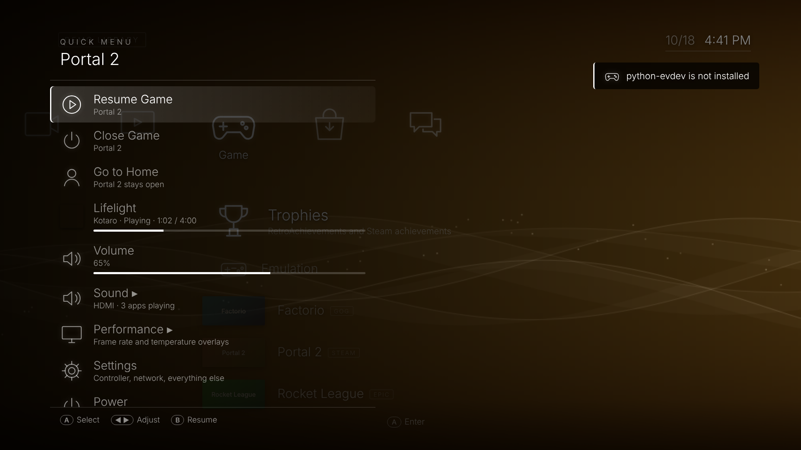 |
| **Pick your voice channels** — Social only shows the ones you turn on in Settings › Accounts › Discord | **Shorter Quick Menu** — Sound and Performance open their own page; long lists scroll |

Also: **Trophies** at the top of Game, a **frame rate overlay** for games (MangoHud), and on a PS5
**ps5_control** is set up for fan modes and boost.

### Earlier

| | |
|---|---|
| 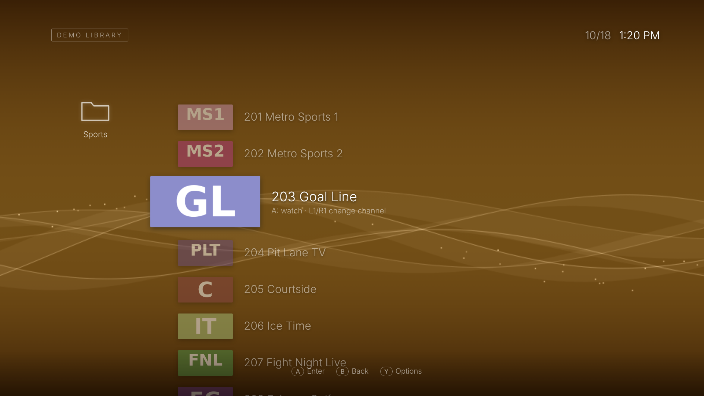 | 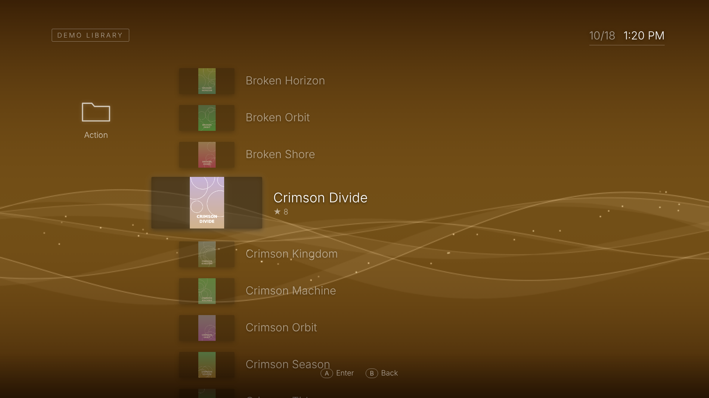 |
| **IPTV Live TV** — your provider's channels with logos; L1/R1 change channel while watching | **IPTV Movies** — posters shown whole, big categories a page at a time |
| 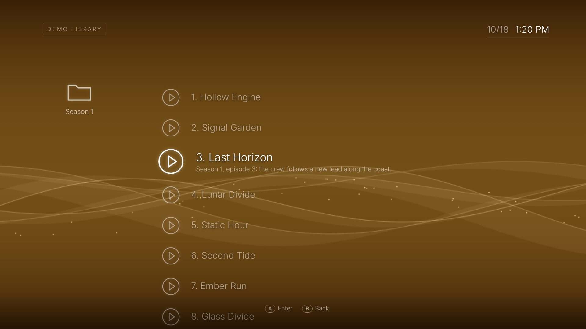 | 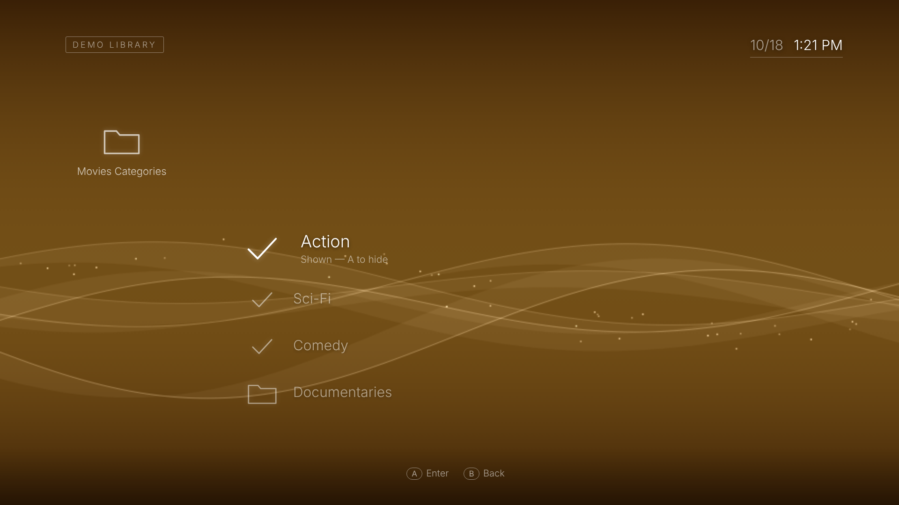 |
| **IPTV TV Shows** — seasons and episodes | **Choose what shows** — pick categories in Settings › Media › IPTV |
| 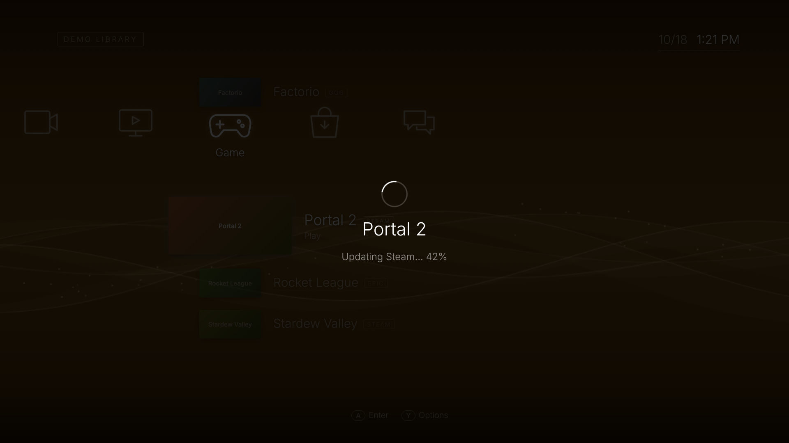 | 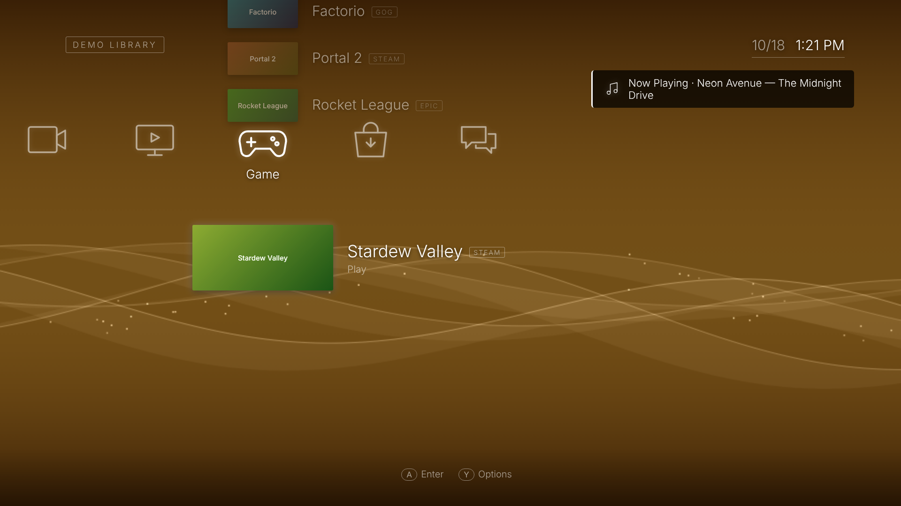 |
| **Steam cold start** — Crossbar waits through Steam's own updates, then starts the game | **Now Playing** — play/pause and skip show the song, anywhere in the menu |
| 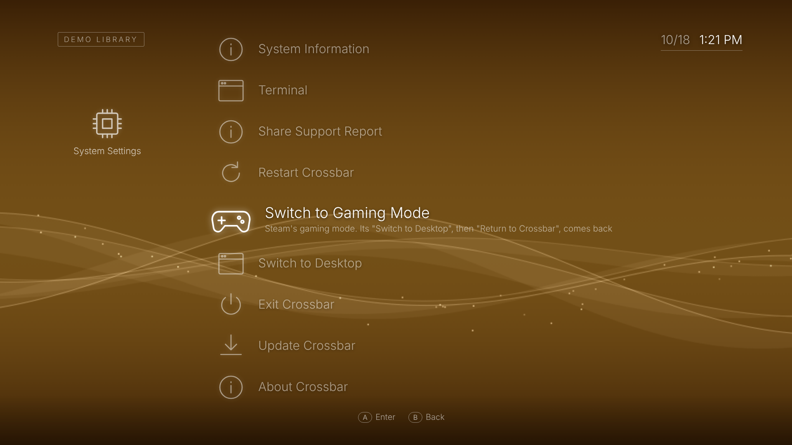 | 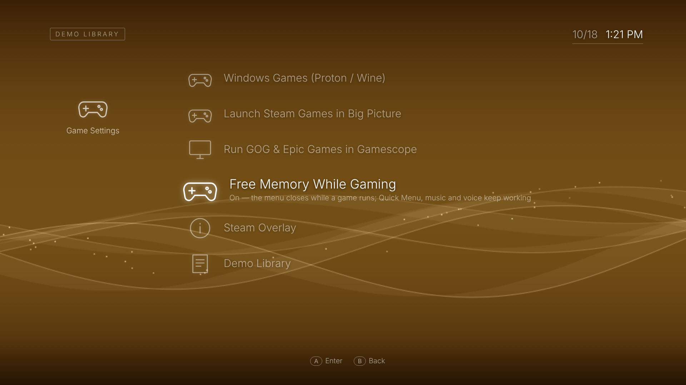 |
| **Settings › System** — Restart Crossbar, and on a PS5 switch to gaming mode or the desktop | **Free Memory While Gaming** — the menu closes while you play; Quick Menu keeps working |

<sub>Screenshots use the demo library and a stand-in IPTV server with invented channels and titles.</sub>

## Run it

**Full install guide (virt-manager and bare metal): [docs/INSTALL.md](docs/INSTALL.md)**

**Quickest — on your current desktop, no ISO (demo library):**

```bash
git clone https://github.com/Brenyd/crossbar.git && cd crossbar
./dev-run.sh            # opens the shell in a Chromium app window
./dev-run.sh --real     # use your real accounts (needs steam / legendary installed)
```

**Build the ISO** (on Arch or CachyOS; needs ~15 GB free and downloads ~3 GB):

```bash
./build-iso.sh          # -> out/crossbar-YYYY.MM.DD-x86_64.iso
./build-in-docker.sh    # same, from any distro with Docker or Podman
```

**Boot it in a VM:**

```bash
./run-vm.sh                     # QEMU/KVM, virgl 3D, 8 GB RAM, 64 GB games disk
NOGL=1 ./run-vm.sh              # if the window is black (no virgl on your host)
PAD=054c:0ce6 ./run-vm.sh       # pass a USB controller through (ids from `lsusb`)
```

To install permanently, open **Settings › Install to Disk** from the live system
(UEFI only, erases the chosen disk). See [docs/INSTALL.md](docs/INSTALL.md).

### Install on an existing CachyOS / Arch system (PS5 included)

Keeps your kernel, bootloader, graphics drivers, NetworkManager, Plasma and your own
autologin/startup setup, and makes the machine boot straight into Crossbar.

```bash
sudo pacman -Syu                      # be fully up to date first (Arch doesn't do partial upgrades)
git clone https://github.com/Brenyd/crossbar.git && cd crossbar
./install-cachyos.sh                  # asks for your password once
sudo reboot
```

Works over SSH (handy on a PS5). What it does:

1. Installs **yay** if you don't have it (from CachyOS's repo, or built from the AUR on plain Arch),
   then the packages Crossbar needs that are missing — repos first, yay for AUR-only ones. **Graphics drivers (mesa, vulkan) are never installed or replaced**, and packages provided
   by something you already have (e.g. a `-git` build) count as installed.
2. Installs Crossbar (`/usr/lib/crossbar`, controller service, device rules, polkit rules).
3. Boots into Crossbar:
   - **TTY autologin (no login manager)** — your getty autologin and startup script stay as they are.
     A 4-line block goes at the top of your login file (`~/.config/fish/conf.d/00-crossbar.fish` for
     fish, else `~/.bash_profile` / `~/.zprofile`). On tty1 it starts Crossbar when
     `~/.config/crossbar/boot-session` says `crossbar`; otherwise it does nothing and your own setup
     runs as before.
   - **Login manager** (Plasma Login Manager / SDDM) — one drop-in, `zzz-crossbar.conf`, read after the
     distro's own autologin file.
4. Adds **Return to Crossbar** to the Plasma app menu.

   - **PS5 (CachyOS PS5 setup)** — detected automatically: its tty1 switcher
     (`/etc/profile.d/ps5-tty-session.sh`, token in `~/.config/ps5-next-session`) gets **crossbar** as a
     third choice next to gamescope/desktop, and the boot default becomes Crossbar (a drop-in for
     `ps5-session-default.service`). Two small marked blocks are added to that script, the original is
     backed up to `/var/lib/crossbar/`, and `--uninstall` restores it exactly. If Crossbar ever fails to
     start, that boot falls back to gaming mode instead of looping. On the PS5, Settings › System has
     **Switch to Gaming Mode** and **Switch to Desktop**; from Plasma, **Return to Crossbar** (app menu)
     comes back; from gaming mode use Steam's Switch to Desktop, then Return to Crossbar (or add
     "Return to Crossbar" to Steam as a non-Steam game).

**Switching:** in Crossbar, **Settings › System › Switch to Your Usual Session** hands tty1 back to
your own startup (Plasma or gaming mode, as you had it). In Plasma, **Return to Crossbar** logs out
and comes back. Whichever was chosen last is what boots next time.

If your usual session needs special environment variables for the display (e.g. exported in your
startup script), put the same `KEY=value` lines in `~/.config/crossbar/session.env` and Crossbar's
session uses them too.

Undo: `./install-cachyos.sh --uninstall` removes the block / drop-in, and you're back to exactly
your previous boot. `--no-autologin` installs without changing what boots. Updates:
**Settings › System › Update Crossbar**.

### Updating without rebuilding the ISO

Code changes in this repo include system parts (services, device rules, packages) that a
plain `git pull` doesn't install. On a running Crossbar (live or installed):
**Settings › System › Update Crossbar**, or press Ctrl+Alt+T and run:

```bash
curl -L https://github.com/Brenyd/crossbar/archive/refs/heads/main.tar.gz | tar xz
cd crossbar-main && ./update-system.sh
```

It installs what's missing, restarts Crossbar in place (the screen goes dark for a moment —
no drop to the TTY), and saves a report to `~/crossbar-report.txt`.
On the live ISO an update lasts until reboot — rebuild the ISO to make it permanent.

## Controls

| Action | Keyboard | Gamepad |
|---|---|---|
| Move | Arrow keys | D-pad / left stick |
| Enter | Enter | A / ✕ |
| Back | Esc | B / ○ |
| Options | Tab | Y / △ |
| Quick Menu (from anywhere, over any app) | Home, or Super+Esc | **Select + Start** together |
| Steam's own overlay (in Steam games) | Shift+Tab | Guide / Steam / PS button |
| Built-in terminal | Ctrl+Alt+T | |
| Play/Pause, previous, next track (in the XMB) | P, Page Up, Page Down | Start, L1, R1 |

**Web apps** (YouTube, Twitch, Plex, the browser) open full screen at your display's
resolution, and the controller works in them too: Crossbar types arrow keys, Enter (A),
Esc (B), Tab (Y) and media keys on a virtual keyboard. YouTube opens in its TV interface,
which is built for exactly this.

Every button and key above can be changed in **Settings › Controller & Keyboard**: pick an
action, press the new button (or key), done. There's also *Swap Select and Back* and
*Reset All to Defaults*. Controllers are read by Crossbar itself and input only goes to
whatever is on screen — the menu, the video player, or nothing (games read the pad directly).

### How controllers work

A small root service, `crossbar-inputd`, reads every controller (so permissions can't get in
the way) and streams it to Crossbar, which applies your mapping and sends each press to
what's in front. While the menu, a video, a web app or the Quick Menu is in front, Crossbar
*holds* the controller so nothing behind reacts too. When a game is in front it lets go, and
the game reads the controller itself. Guide/PS always reaches the Quick Menu.

### If something isn't working

**Settings › System › Share Support Report** uploads a diagnostic report and shows a
short link — paste that link when asking for help.

### If the controller works in the menu but not in videos, web apps or the Quick Menu

Check `systemctl status crossbar-inputd` (it should be *active*). Without it Crossbar falls
back to reading the controller directly, which needs permissions.
**Settings › Controller & Keyboard › Controller Diagnostics** shows what Crossbar sees and
the last buttons it received. For a full report press Ctrl+Alt+T and run `crossbar-doctor`.
The ISO ships a udev rule (`/etc/udev/rules.d/70-crossbar-input.rules`) that gives the
console user access to controllers and `/dev/uinput`. On an existing install, copy that rule
in and reboot. In a VM, pass the controller through as a USB device.

## PS5 hardware (Linux on a PS5)

When the PS5 fan and LED kernel drivers are present, **Settings › PS5 Hardware** shows up:

- **Temperatures** — CPU, GPU and NVMe, read straight from the sensors.
- **Temperature Overlay** — a small box with the temperatures in a corner of your choice, on top of
  everything including games (it never takes input).
- **Fan Target Temperature** — 40–95 °C: the fan speeds up to keep the chip below it (lower = cooler,
  louder). Remembered and re-applied at every start.
- **Fan Mode / Boost** — fixed patterns (On / Off / Max) through `ps5_control`. On a PS5, installing or
  updating Crossbar downloads [ps5-linux/ps5-linux-tools](https://github.com/ps5-linux/ps5-linux-tools)
  and builds `ps5_control` into /usr/local/sbin (`./ps5-tools.sh` does just that step; `--update`
  rebuilds it). Its `ps5fan` / `ps5boost` services are installed but left off. It isn't shipped
  inside Crossbar because that project has no license yet. Nothing else is touched: not the kernel,
  drivers or boot setup.
- **Front Light** — every colour and animation the LED driver offers.

The Quick Menu has the temperatures (A shows/hides the overlay) and the fan target (◀ ▶).
Thanks to [syrufex/PS5-Temperature-Control-Panel-Linux](https://github.com/syrufex/PS5-Temperature-Control-Panel-Linux)
(MIT), whose app showed which driver interfaces to use; Crossbar's version is its own code and UI.

## Button glyphs

**Settings › Controller & Keyboard › Button Glyphs**: Automatic (matches the connected controller),
Xbox (A B X Y), PlayStation (✕ ○ □ △) or Nintendo (B A Y X). Every hint uses them — the menu, the
Quick Menu, the video player's panel and the remapping screen — and they follow your button mapping,
so a remapped action shows the button you actually press. Glyphs follow the button's *position*
(the bottom button is ✕ / A / B), so on a Nintendo pad confirm is **B**; turn on
**Swap Select and Back** if you'd rather confirm with A like on a Switch.

## Quick Menu

Press **Select + Start** (or **Home**) during a game, video or app. The Quick Menu slides in
**on top of** whatever is running — a native window on the Wayland overlay layer, like the
Steam or Discord overlay — and takes the controller and keyboard while it's open, so the game
underneath doesn't react. Guide/PS is left to Steam by default (Settings › Controller &
Keyboard can give it to Crossbar instead). It has:

- **Resume** / **Close** the game or video (closing returns you straight to the XMB)
- **Go to Home** — the XMB, leaving the game open
- **Now Playing** — your music or Spotify: ◀ ▶ skip, A play/pause
- **Volume** (◀ ▶, A mutes)
- **Sound ▸** — its own page: **Sound Output** switch, **Microphone** mute, and **App Volume**: every
  app playing sound right now (Spotify, a game, Discord, a video, YouTube…) with its own level
  (◀ ▶ changes it, A mutes it). Also in Settings › Display & Sound › Sound › App Volume.
- **Performance ▸** — **Frame Rate Overlay** (◀ ▶ Off / FPS only / FPS + frame time graph / Full with
  CPU, GPU and temperatures; A turns it on or off), its **position**, and on a PS5 the
  **Temperature Overlay** and **Fan Target**. Changes show up in the running game straight away.
- **Switch App** — every open app and game, plus Crossbar: A switches to it, Y opens
  **Switch To / Close / Force Close** (force close ends a frozen app right away)
- **Keyboard** — the on-screen keyboard, for apps that don't open it themselves
- **Settings ▸** — jump to Controller & Keyboard, Display, Network or the full Settings
- **Power…** — its own page that opens with **Cancel** selected: Restart Crossbar, Restart
  Computer, Turn Off Computer. A stray A press can't turn the machine off.

B goes back a page (back to the row you came from), or on the first page resumes what you were
doing. When a page has more rows than fit on screen it scrolls, with ▲ / ▼ showing there's more.

The **frame rate overlay** is [MangoHud](https://github.com/flightlessmango/MangoHud): games Crossbar
starts load it hidden, so turning it on works mid-game. It works in Vulkan games, including Windows
games through Proton. Steam games get it when Crossbar starts Steam (if Steam was already open,
restart Steam once). Also in Settings › Games & Emulation › Game Settings › Frame Rate Overlay.

If the Quick Menu ever fails to appear, Crossbar notices within a second and a half, gives the
controller back and opens the menu inside the XMB instead.

**Game mode (saves memory):** when a game starts, the XMB window — a full browser and the biggest
part of Crossbar — closes. The backend, Quick Menu, controller service, music, Spotify and Discord
voice keep running, so everything in the Quick Menu still works. **Go to Home** (or quitting the
game) brings the XMB back in a couple of seconds. Turn it off in Settings › Games & Emulation › Game Settings › Free
Memory While Gaming. (It stays off if the Quick Menu overlay isn't available, so there's always a
way back.)
**While a video plays** (panel hidden): A pause · ◀/▶ seek −10 s/+30 s · ▲/▼ volume ·
L1/R1 previous/next · Y show panel · B jump to Stop. With the panel open, ◀/▶ pick a
button (previous, rewind, play/pause, forward, next, subtitles, audio track, stop), A presses
it, B hides it. Videos resume where you stopped (toggle in Settings › Media).

**Photo viewer:** ◀/▶ browse · A slideshow · Y hide captions · B back.

## Music, Video, Photo

Pick your library folders in **Settings › Media** (defaults `~/Music`, `~/Videos`,
`~/Pictures`; any drive under `/run/media` or `/mnt` works). Browse by folder, or use
**All Songs / All Videos**.

- **Music** plays through a hidden mpv and keeps going while you browse or play games.
  *Now Playing* sits at the top of Music; A pauses, Y gives next/previous/shuffle/repeat/stop.
  Tags and album art come from the files (or a `cover.jpg` in the folder).
- **Video** opens mpv full screen with Crossbar's own control panel. Home pauses it and
  returns to the XMB; *Return to…* at the top of Video picks it back up.
- **Photo** shows thumbnails, a full-screen viewer and slideshows.
- **TV & Video Services** opens web apps in their own window: YouTube (its TV interface,
  made for controllers), Twitch, Plex, plus anything you add (Jellyfin, etc.).

## Spotify

Crossbar becomes a **Spotify Connect speaker named "Crossbar"** (via librespot), and the
Music › Spotify folder browses your Liked Songs and playlists, searches, and plays them on
it, with a Now Playing item and controls like local music. You can also start music on your
phone and move it to Crossbar with **Play on Crossbar**.

Spotify's rules (since February 2026) mean a one-time setup:

1. You need **Spotify Premium** (Connect playback and developer apps both require it).
2. On any device, open [developer.spotify.com/dashboard](https://developer.spotify.com/dashboard), **Create app**.
   Redirect URI: `http://127.0.0.1:7777/spotify/callback`. Tick **Web API**. Save.
3. On Crossbar: **Music › Spotify › Set Up Spotify**, paste the **Client ID**, sign in once in
   the window that opens (and allow access). Press Home if the window doesn't close itself.

After that it just works, every boot. If playing from Crossbar fails, use **Settings › Account
Settings › Restart Spotify Speaker**; the speaker's log is `~/.cache/crossbar/librespot.log`. Developer-mode apps allow up to 5 accounts; playlists
you don't own can be played but their track list can't be shown (a Spotify restriction).

## Social: friends and Discord voice

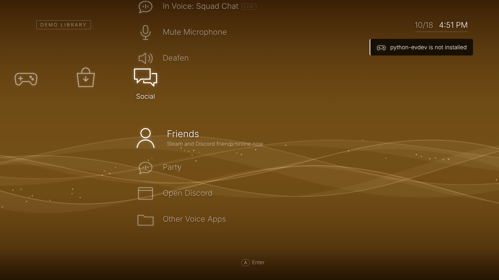

- **Friends › Steam** — who's online and what they're playing (needs the same free Steam Web API key
  as Trophies, and your Steam Friends List set to Public).
- **Friends › Discord** — friends online now; **A calls them** on Discord (voice runs in Crossbar's
  hidden Discord window, so you can keep playing).
- **Party** — the Discord voice channels you chose: A joins (or leaves).
- While you're in a call or channel it sits at the top of Social with Mute / Deafen, and the Quick
  Menu shows it too (A mutes, ◀ leaves). No developer app or setup.

How it works: Crossbar runs Discord's own web client (discord.com/app) in a window it keeps hidden,
and drives it the way you would, by clicking the voice channel, Disconnect, Mute and Deafen,
through Chromium's private DevTools pipe (only Crossbar's backend can use it; no open port).
Things are found by their accessibility labels, not screen positions, so Discord's redesigns
rarely break it; if one does, an action reports "couldn't find" and **Open Discord** still works.

1. **Social › Sign In to Discord**: Discord shows a QR code; scan it with the Discord app on your phone.
2. **Settings › Accounts › Discord › Voice Channels in Social** (or Social › Party › Choose Voice
   Channels) › a server: every voice channel is hidden until you turn it on (A shows / hides it),
   so Party only lists the ones you use.
3. **Open Discord** shows the full client (text chat, friends) with controller keys and the
   on-screen keyboard; the Quick Menu brings you back.

Automating your own Discord client is a grey area in Discord's terms; Crossbar only does what you
ask for (join, leave, mute) and never reads or sends messages on its own.

## Emulation

**Game › Emulation** has **ROMs** (a folder per system, shown once it has games; A plays) and
**Emulators** (install / uninstall, from Flathub; DuckStation as its official AppImage). Games
launch like any other: the "Starting…" screen, the memory-saving game mode, and the Quick Menu's
Close to quit. Folder layout is EmuDeck's, so an existing EmuDeck folder works as-is:

```
~/Emulation/roms/<system>/   nes snes n64 gb gbc gba nds n3ds gc wii wiiu mastersystem genesis segacd
                             gamegear saturn dreamcast psx ps2 ps3 psp xbox pcengine atari2600 arcade scummvm
~/Emulation/bios/            BIOS / firmware files
```

**Settings › Games & Emulation › Emulation**: the folder, **BIOS Files** (checked per system, with what's missing),
**Emulator Settings & Controls** (opens each emulator to map buttons; pads are detected
automatically), **Default Emulator per System**, **Aspect Ratio**, **Pixel-Perfect Scaling** and
**RetroAchievements** (sign in once; emulators get a login token, not your password). Crossbar writes
these into RetroArch, Dolphin, PCSX2, DuckStation and PPSSPP's own settings.

## Trophies

**Game › Trophies**: **RetroAchievements** by console (your points and rank, each game's progress,
every badge) once you add your Web API key (retroachievements.org › Settings › Keys), and **Steam**
achievements per game with a free Steam Web API key (steamcommunity.com/dev/apikey; your profile's
Game details must be public). GOG and Epic aren't listed: they don't share achievements with other apps.

## On-screen keyboard

Text fields open a QWERTY keyboard when you're using a controller: A types, B deletes, Y/△ is
shift, L1/R1 move the cursor, Start is Done. Touch a real keyboard or mouse and it closes.
In other apps it opens by itself in apps that support Wayland's text-input (GTK, Qt, and Crossbar's
own web windows like Discord and TV apps), typing any character; anywhere else use **Quick Menu ›
Keyboard**. It stays away from Steam, which has its own.

## Artwork (SteamGridDB)

Highlight any game — Steam, GOG, Epic or a ROM — press **Y** and choose **Change Artwork…** to pick
from [SteamGridDB](https://www.steamgriddb.com)'s community artwork, search under a different name,
or go back to the original. Needs a free API key (steamgriddb.com › sign in › Preferences › API),
added in **Settings › Games & Emulation › Artwork**. With the key, games that have no picture (most
ROMs, some GOG / Epic games) get one automatically in the background (turn off with **Fill In
Missing Artwork**). Your picks are kept in Crossbar's settings; **Reset All Artwork** undoes them.

## Games

Sign in to **Steam, GOG and Epic** in **Settings › Accounts**; your libraries then show
in **Store**, and installed games in **Game**.

- If Steam isn't running yet — or is updating itself — Crossbar starts it first, shows Steam's
  update progress on the "Starting…" screen, and only sends the game once Steam is fully up
  (a game sent while Steam updates is otherwise lost).
- **Steam** games launch through **Big Picture** (Steam's console mode) by default, so Steam Input
  and Steam's overlay work like on a Steam Deck. When the game ends — or you close it from the
  Quick Menu — Steam is tucked away and you're back in Crossbar. (Toggle in Game Settings.)
- **If a game won't start**, the error comes from the game itself (for example a missing file or a
  Wine/Proton message) instead of just "didn't open a window"; full output is in `~/.cache/crossbar-games.log`.
- **GOG** Windows games install from GOG's own installers (unpacked with innoextract) and run with
  Proton through **umu-launcher**; native Linux builds are used when GOG has one.
- **Epic** games run through the same Proton setup (legendary + umu).
- **Settings › Games & Emulation › Game Settings › Windows Games**: choose the default tool (UMU-Proton, newest
  GE-Proton, a GE-Proton version you download there, Steam's Proton, or Wine). Per game:
  Y › *Compatibility Tool…*. Each game gets its own prefix in `~/Games/prefixes`.
- Closing a game from the Quick Menu asks it to quit, and ends it if it hangs.

Launching shows a *Starting…* screen until the game's window appears, then hands over. Steam runs
in the background with its library window tucked away, and **Steam's overlay works normally**
inside Steam games. GOG and Epic games can optionally run in gamescope (Settings › Games & Emulation › Game Settings).
When a game closes you're back in the menu.

## Files, network drives, IPTV

- **Users › File Browser** — your home folder, USB drives and network drives: open media,
  copy / cut / paste, rename, new folder, move to Trash (restorable) or delete permanently.
- **Settings › Network Settings › Network Drives** — add an SMB (Windows/Samba, most NAS boxes) or
  NFS share: server, share, username, password (or paste the whole address, like `\\nas\Media` or
  `//192.168.0.50/Media`). The connection is tested first and nothing is saved if it fails; you get the
  reason (NAS unreachable, wrong share name with the list of shares it has, wrong password, or an
  old NAS that only speaks SMB1, which is then used automatically). It's written to `/etc/fstab` as an on-demand mount
  under `/mnt/nas/<name>` (with `nofail`, so an offline NAS never blocks boot); the password lives in
  a root-only file in `/etc/crossbar/nas/`, never in fstab. Use a drive as your Music/Video/Photo
  folder from its options.
- **IPTV (Xtream Codes)** — **Settings › Media › IPTV**: sign in with the server, username
  and password from your provider, then choose which **Live TV**, **Movie** and **TV Show**
  categories appear (and hide channels you don't want). Live TV shows under TV & Video Services
  (L1/R1 change channel while watching); Movies and TV Shows under Video.
  Big Movie / TV Show categories are shown 60 titles at a time (**More…** at the end).
  If sign-in times out, use the exact address your provider gave **including the port**
  (e.g. `http://example.com:8080`); without one, Crossbar tries the usual Xtream ports (8080,
  25461, 8000, 80). Requests identify as VLC, since many providers block unknown players.

## Settings

The Settings column groups related sections: **Display & Sound**, **Network & Bluetooth**,
**Controller & Keyboard**, **Games & Emulation** (Game Settings, Artwork, Emulation), **Media**,
**Accounts**, **Theme & Time** and **System** (with PS5 Hardware on a PS5).

| Section | What's in it |
|---|---|
| Display | Resolution, refresh rate, scale per screen; new modes auto-revert after 15 s unless you choose Keep. Screens that report no modes get common sizes as custom modes, rate shown as Auto |
| Sound | Output device, input (mic) device, volumes, menu sounds |
| Network | Status, Wi-Fi on/off, scan, connect, disconnect, forget; network drives (SMB/NFS) |
| Bluetooth | On/off, find devices, pair controllers and headsets, connect, forget |
| Controller & Keyboard | Remap every button and key, button combos, Guide/PS option, swap Select/Back, diagnostics |
| Game Settings | Windows games (Proton/Wine picker, GE-Proton downloads), Big Picture launching, gamescope, free memory while gaming, frame rate overlay, demo library |
| Artwork | SteamGridDB API key, fill in missing artwork, reset all |
| Theme | Background colour, or automatic by month |
| Media | Music / Video / Photo folders, IPTV, resume videos, subtitles default |
| Date & Time | Time zone, automatic time, 12/24-hour clock |
| Accounts | Steam, GOG, Epic sign-in; Spotify; Discord (sign in, which voice channels show in Social); user name |
| System | Terminal, **Restart Crossbar** (restarts every Crossbar piece — useful while testing), **Exit Crossbar**, update, share support report, system information, install to disk |

Everything is set inside Crossbar — no separate settings apps. Under the hood these are the same
system services KDE Plasma's settings use (NetworkManager, BlueZ, PipeWire, systemd), driven
directly.

## How the stores connect

Starts in **demo mode** with sample games so everything is clickable. Turn it off in
Settings › Demo Library, then sign in from Store.

| Store | Sign-in | Downloads | Launch |
|---|---|---|---|
| Steam | SteamID64 + Web API key lists your library; the Steam client signs in on first install | Steam client (`steam://install`), progress read from its appmanifest files | `steam://rungameid` |
| GOG | Official GOG sign-in page in a web view (same OAuth flow Minigalaxy/Heroic use) | Native Linux installers via GOG's API | `start.sh` |
| Epic | Epic sign-in page in a web view → `legendary auth` | `legendary install`, live progress | `legendary launch` (Wine) |

Everything lives under `~/Games`, which in the VM is the 64 GB `games.qcow2` disk. Steam,
legendary and Crossbar settings are kept there too, so they survive reboots of the live ISO.

## Party chat

Pick a voice service (Discord app or web, Mumble, TeamSpeak, Element), hit **Start Party**, and
press Home to come back to the XMB while voice keeps running. **Quick Join** stores channel
links (paste a `discord.com/channels/…` link and it opens in the Discord app).

## Layout

```
shell/server.py               backend: JSON API + serves the UI (stdlib only)
shell/crossbar/providers/     steam.py, gog.py, epic.py, demo.py
shell/crossbar/system.py      sway windows, audio devices, Wi-Fi, power
shell/crossbar/gamepad.py     reads every controller, applies the mapping, routes to what's in front
shell/crossbar/controls.py    button/key mapping (~/.config/crossbar/controls.json)
shell/crossbar/quick.py       Quick Menu: open over the app in front, resume / close it
shell/inputd.py               crossbar-inputd: root controller service (grab, virtual keyboard)
shell/overlay.py              crossbar-overlay: GTK4 layer-shell window hosting web/overlay.html
shell/crossbar/media.py       library folders, tags, thumbnails, folder picker
shell/crossbar/player.py      mpv music (hidden) and video (full screen) over IPC
shell/crossbar/spotify.py     librespot Connect speaker + Spotify Web API
shell/crossbar/display.py     resolution / refresh / scale via sway
shell/crossbar/party.py       voice services + channels
shell/mpv/crossbar-osc.lua    the controller-friendly video control panel
shell/crossbar/login_helper.py  web-view window for GOG/Epic sign-in
shell/web/                    the XMB: xmb.js (core), media.js (Photo/Music/Video/TV/Network), quick.js, settings.js
iso/                          archiso overlay: packages, autologin, sway session, boot setup
```

Boot path: autologin `player` on tty1 → sway (tabbed, so one app is visible at a time) →
`crossbar-shell` starts the backend and a kiosk Chromium window → the XMB.

## Known gaps (next steps)

- GOG Windows-only games and Epic games run through plain Wine; Proton/umu integration is next.
- Steam owned-games listing needs a Web API key; a QR/password login through the client would be smoother.
- Netflix/Disney+/Spotify's web player need Widevine DRM, which Arch's Chromium doesn't ship.
- In the YouTube TV interface the controller works only if the site picks it up; arrow keys always work.
- The installer erases the whole disk (no dual-boot), and NVIDIA drivers aren't included yet.
- Party is a launcher, not an in-game overlay (Discord's API doesn't allow a third-party voice UI).
