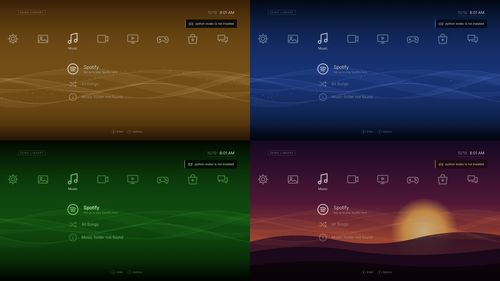

# Making a Crossbar theme

A theme changes how Crossbar looks and sounds: colours, the wave background (or a picture or
video behind it), the font, any menu icon, the on-screen keyboard, the Quick Menu, and the menu
sounds. It's just a folder: no code, no rebuilding. Crossbar checks everything in it, so a mistake
can't break the menu, it just falls back to the Classic look for that part.



## Quick start

1. Copy a stock theme as a starting point, from
   [`shell/themes/`](../shell/themes) (on an installed system: `/usr/lib/crossbar/themes/`):
   ```sh
   mkdir -p ~/.local/share/crossbar/themes
   cp -r /usr/lib/crossbar/themes/midnight ~/.local/share/crossbar/themes/my-theme
   ```
2. Edit `~/.local/share/crossbar/themes/my-theme/theme.json` (change at least `"name"`).
3. In Crossbar: **Settings › Theme & Time › Theme**, pick it. Changes show the moment you pick it;
   after editing files, pick it again to reload.

To share a theme, zip the folder. Others install it with **Settings › Theme & Time › Theme ›
Install a Theme…**: pick the `.zip` (or the folder) on a USB stick, in Downloads or on a network
drive. Themes you added can be removed there too (Y › Remove).

## The folder

```
my-theme/
├── theme.json          required: name, colours, waves… (everything below is optional)
├── background.jpg      a picture (or .png .webp .svg .gif) or video (.mp4 .webm) behind the menu
├── preview.png         shown in the theme list (else the background is used)
├── font.woff2          a font file (.woff2 .woff .ttf .otf)
├── icons/
│   ├── game.svg        replaces the Game icon — any icon, by name (list below)
│   └── music.png
├── sounds/
│   ├── move.ogg        moving around      (.ogg .mp3 .wav .opus)
│   ├── ok.ogg          selecting
│   ├── back.ogg        going back
│   └── err.ogg         something went wrong
└── theme.css           advanced: extra CSS for the menu page
```

Folder name = theme id: lowercase letters, numbers, `-` and `_`. A theme with the same id as a
stock theme replaces it.

## theme.json

Every key is optional; anything left out comes from Classic. Colours can be `#rrggbb`,
`#rrggbbaa`, `rgb(…)`, `rgba(…)` or a colour name. The wave colours (`high`, `low`, `lines`)
must be `#rrggbb`.

```json
{
  "name": "My Theme",
  "author": "You",
  "description": "One line shown in Settings",
  "colors": {
    "accent": "#5aa9ff", "text": "#ffffff", "dim": "rgba(255,255,255,.55)",
    "highlight": "rgba(90,169,255,.22)", "panel": "rgba(4,10,24,.92)"
  },
  "waves": { "mode": "fixed", "high": "#2c5fd6", "low": "#020814", "lines": "#a8c8ff", "sparkles": true, "opacity": 1.0 },
  "background": { "image": "background.jpg", "dim": 0.3, "blur": 0, "waves_on_top": true },
  "font": { "family": "Noto Sans", "weight": 300, "file": "font.woff2" },
  "icons": { "glow": true, "color": "#e6efff" },
  "keyboard": {
    "background": "rgba(4,12,30,.92)", "key": "rgba(90,169,255,.10)", "key_text": "#dce9ff",
    "highlight": "#5aa9ff", "highlight_text": "#02101f", "radius": 14
  },
  "quick_menu": { "panel": "rgba(4,10,24,.93)", "highlight": "rgba(90,169,255,.25)", "accent": "#5aa9ff" }
}
```

| Key | What it does |
|---|---|
| `colors.accent` | highlights, toast edges, progress bars (`null`: follow the waves) |
| `colors.text` / `colors.dim` | main text / secondary text |
| `colors.highlight` | the selected row in dialogs and the menu's Quick Menu |
| `colors.panel` | toasts and panels |
| `waves.mode` | `month` (changes every month, like Classic), `fixed` (your `high`/`low`), `off` |
| `waves.lines`, `sparkles`, `opacity` | wave line colour, the drifting sparkles, how strong the waves are (0–1) |
| `background.image` | picture or video file in the theme folder |
| `background.dim` / `blur` | darken (0–1) and blur (pixels) it so text stays readable |
| `background.waves_on_top` | `false`: just the picture, no waves |
| `font.family` / `weight` / `file` | a font installed on the system, or your own font file |
| `icons.glow` / `icons.color` | the soft glow around icons, and their colour |
| `keyboard.*` | the on-screen keyboard (both the menu's and the one over apps) |
| `quick_menu.*` | the Quick Menu over games and apps |

`font.family` can be any font installed on the system (e.g. `"Noto Sans Mono"`) or, with
`font.file`, your own font file.

## Icons

Put a file named after the icon in `icons/`. **SVG is best**: draw on a 64×64 `viewBox` with
`stroke="currentColor"` (or `fill="currentColor"`) and it takes the menu's colours and glow, like
the built-in icons. PNG/WebP work too (shown as pictures). Scripts and links in SVGs are removed.

```svg
<svg xmlns="http://www.w3.org/2000/svg" viewBox="0 0 64 64" fill="none" stroke="currentColor" stroke-width="4">
  <path d="M8 22h48v20H44v6H20v-6H8z"/>
</svg>
```

Icon names:

| Where | Names |
|---|---|
| Categories | `users` `settings` `photo` `music` `video` `tv` `game` `store` `party` |
| Common | `folder` `play` `download` `search` `info` `check` `add` `power` `restart` `link` `window` `browser` |
| Media & apps | `spotify` `sound` `mic` `voice` `trophy` `retro` `palette` `display` `network` `wifi` `account` `user` `demo` |

(The full list is the `ICONS` table in [`shell/web/icons.js`](../shell/web/icons.js).)

## theme.css (advanced)

Plain CSS for the menu page, loaded last. Useful CSS variables:

```css
:root {
  --accent; --text; --dim; --hl; --panel; --font; --font-weight;
  --icon-color; --icon-glow;
  --kb-bg; --kb-key; --kb-text; --kb-hl; --kb-hl-text; --kb-radius;
}
```

`body[data-theme="your-id"]` is set while your theme is on. The Phosphor theme's `theme.css`
(scanlines over everything) is a small example. CSS only styles the menu; the Quick Menu and the
system keyboard use the colours from `theme.json`.

## Stock themes

| Theme | Shows off |
|---|---|
| **Classic** | the original look: waves that change colour every month (Settings › Theme › Wave Colour) |
| **Midnight** | fixed wave colours, keyboard and Quick Menu colours |
| **Phosphor** | a system font (monospace), replaced icons, `theme.css` scanlines |
| **Sunset** | a background picture (`background.svg`) with the waves over it |
